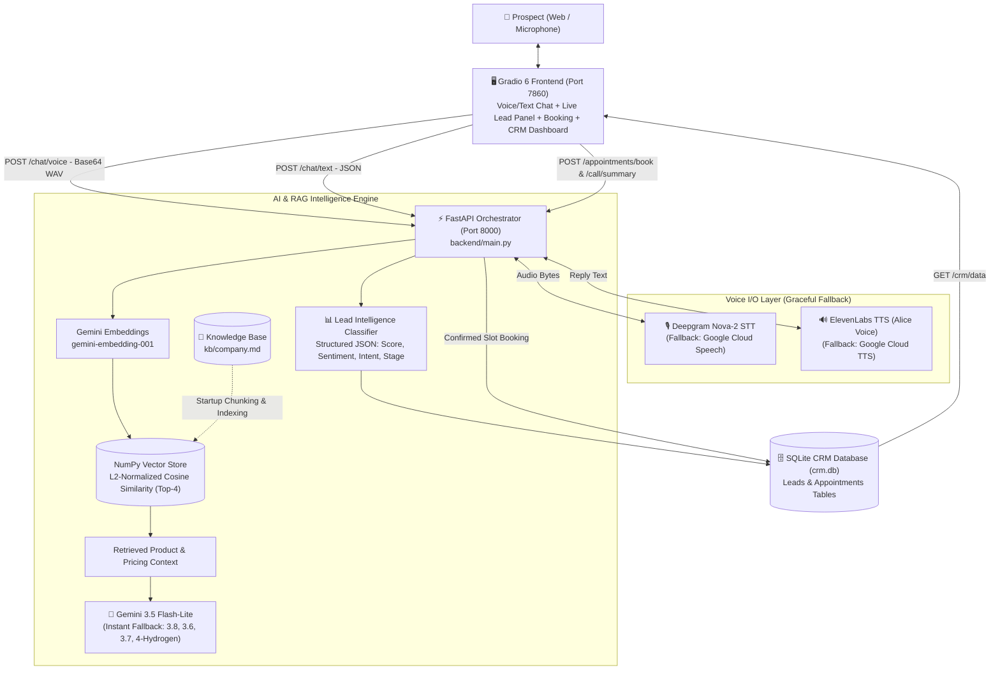
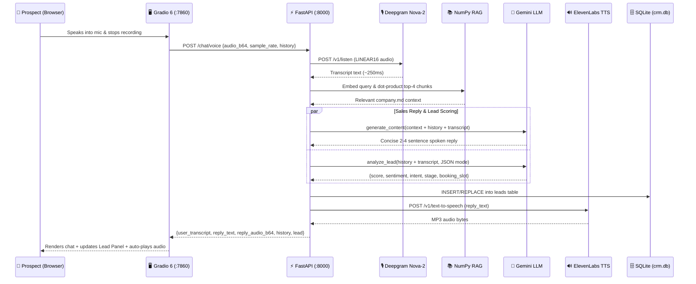
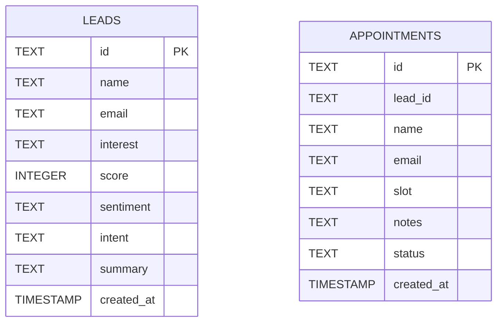
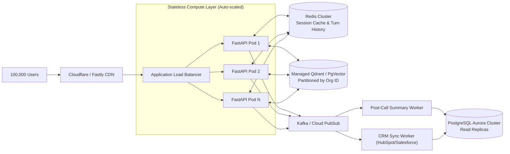

# 🤖 Autonomous AI Sales Voice Agent + CRM Pipeline

> **🎬 Live Demo Video (Full End-to-End Walkthrough):**  
> 👉 **[Watch the Project Demo on YouTube](https://youtu.be/sMdc9fFcNww?si=L5Llv_GcRInT4rTa)** (`https://youtu.be/sMdc9fFcNww?si=L5Llv_GcRInT4rTa`)

An enterprise-grade, end-to-end **Autonomous AI Sales Voice & Chat Agent** built with **FastAPI**, **Gradio 6**, **Google Gemini**, **Deepgram Nova-2 (STT)**, **ElevenLabs (TTS)**, and an integrated **SQLite CRM & Lead Qualification Pipeline**.

The agent, named **Alex**, acts as an autonomous sales representative for **TechNova Solutions** (defined in [`kb/company.md`](kb/company.md)), answering questions via natural voice and text, scoring leads in real time, booking demos, saving data to a CRM database, and generating post-call executive summaries.

---

## 📋 Table of Contents

- [1. Mandatory Project Guidelines Compliance](#-1-mandatory-project-guidelines-compliance)
- [2. Business Problem & Solution](#-2-business-problem--solution)
- [3. System Architecture Diagram](#-3-system-architecture-diagram)
- [4. End-to-End Business Workflow](#-4-end-to-end-business-workflow)
- [5. Technical Implementation Details](#-5-technical-implementation-details)
- [6. Project Structure & Tech Stack](#-6-project-structure--tech-stack)
- [7. Setup & Running Locally](#-7-setup--running-locally)
- [8. Evaluation Demonstration Walkthrough](#-8-evaluation-demonstration-walkthrough)
- [9. Scalability Strategy (Supporting up to 100,000 Users)](#-9-scalability-strategy-supporting-up-to-100000-users)
- [10. Data Security, Infrastructure & Deployment](#-10-data-security-infrastructure--deployment)
- [11. Operational Costs & Commercial Feasibility](#-11-operational-costs--commercial-feasibility)
- [12. Live Coding, Debugging & Real-Time Modifications](#-12-live-coding-debugging--real-time-modifications)

---

## 📌 1. Mandatory Project Guidelines Compliance

This project directly fulfills all mandatory evaluation criteria:

| Evaluation Guideline | Project Implementation & Proof Point |
|---|---|
| **Functional MVP / Working Prototype** | Complete runnable solution with FastAPI backend (`:8000`) and Gradio 6 UI (`:7860`). |
| **Technology Stack Freedom** | Python 3.14, FastAPI, Gradio 6, Google Gemini (`gemini-3.5-flash-lite`), Deepgram Nova-2 STT, ElevenLabs TTS, SQLite CRM. |
| **Source Code Availability** | Fully documented and clean repository with zero dead code or external package bloat. |
| **System Architecture Diagram** | Detailed Mermaid diagram illustrating Client, STT, RAG, LLM, TTS, and CRM layers ([Section 3](#-3-system-architecture-diagram)). |
| **Complete End-to-End Business Workflow** | 4-turn sales lifecycle: Discovery → RAG Plan Pitch → Objection Handling → Appointment Booking ([Section 4](#-4-end-to-end-business-workflow)). |
| **Problem, Implementation & Feasibility** | Deep dive into inbound sales friction, technical RAG/Voice implementation, and unit economics showing an **88%+ gross margin** ([Section 2](#-2-business-problem--solution) & [Section 11](#-11-operational-costs--commercial-feasibility)). |
| **Scalability Strategy (1,00,000 Users)** | Blueprint for 100k users covering Redis session clusters, managed vector DBs, WebRTC/Gemini Live streaming, and Kafka/PubSub workers ([Section 9](#-9-scalability-strategy-supporting-up-to-100000-users)). |
| **Data Security & Infrastructure** | TLS 1.3, AES-256 encryption, PII redaction, Dockerized microservices, and CI/CD pipelines ([Section 10](#-10-data-security-infrastructure--deployment)). |
| **Live Coding & Real-Time Modifications** | Prepared live modification playbooks for rapid knowledge updates, persona adjustments, and pricing tweaks ([Section 12](#-12-live-coding-debugging--real-time-modifications)). |

---

## 🎯 2. Business Problem & Solution

### The Business Problem
Inbound B2B sales teams face four fundamental bottlenecks:
1. **Lead Drop-Off Due to Latency:** Up to 78% of B2B buyers purchase from the vendor that responds first. Human response times often take hours or days, causing prospects to churn.
2. **High 24/7 Coverage Costs:** Staffing round-the-clock Sales Development Representatives (SDRs) across multiple time zones is cost-prohibitive for SMBs and mid-market companies ($4,000–$6,000/month per rep).
3. **Inconsistent Pitching & Hallucinations:** Junior reps frequently misstate complex pricing, omit compliance guarantees (SOC 2, GDPR, HIPAA), or mishandle standard pricing objections.
4. **CRM Admin Burden:** Sales reps spend over 30% of their workday manually typing notes, updating deals, and logging demo requests rather than selling.

### The Technical Solution
**Alex**, an autonomous AI voice and chat sales agent:
- Answers inquiries instantly 24/7 with zero human wait time.
- Uses **Retrieval-Augmented Generation (RAG)** grounded in [`kb/company.md`](kb/company.md) to eliminate hallucinations.
- Transcribes voice in real time with **Deepgram Nova-2** and speaks with realistic **ElevenLabs** voice synthesis.
- Computes turn-by-turn **Lead Qualification Scores (0–100)**, **Sentiment**, and **Intent**.
- Automatically captures contact details, confirms demo slots, and logs everything to a persistent **SQLite CRM** with post-call executive summaries.

---

## 🏗️ 3. System Design & Architecture

### A. High-Level Component Architecture



### B. End-to-End Voice Turn Sequence Diagram



### C. REST API Contract (`backend/main.py`)

| Method & Endpoint | Purpose | Key Payload / Response |
|---|---|---|
| `GET /health` | Readiness & provider check | `{"status":"ok","kb_chunks":20,"deepgram_configured":true,"elevenlabs_configured":true}` |
| `POST /chat/text` | Text turn + RAG + Lead scoring + TTS | In: `{message, history}` → Out: `{user_transcript, reply_text, reply_audio_b64, history, lead}` |
| `POST /chat/voice` | Voice turn: STT → RAG → LLM → Lead → TTS | In: `{audio_b64, sample_rate, history}` → Out: `AgentResponse` |
| `POST /appointments/book` | Persist confirmed demo slot | In: `{name, email, slot, notes}` → Out: `{status, appointment_id, slot, message}` |
| `GET /crm/data` | Fetch CRM tables for UI | Out: `{leads: [...], appointments: [...]}` (latest 20 each) |
| `POST /call/summary` | Generate structured post-call insights | In: `{history}` → Out: `{summary: {executive_summary, key_pain_points, recommended_plan, objections_raised, next_best_action}}` |

### D. CRM Database Schema (`crm.db`)



---

## 🔄 4. End-to-End Business Workflow

The system executes a complete 4-stage inbound sales funnel for **TechNova Solutions**:

```text
[Step 1: Discovery]
   User: "Hi, I have a 12-person sales team and need help automating follow-ups."
   System: Deepgram transcribes audio → RAG pulls Growth Plan details ($79/mo, 15 users, 300 Voice AI mins).
   Alex: "Our Growth Plan at $79 a month is ideal for a 12-person team. It includes full CRM automation,
          300 minutes of Voice AI, and Slack/HubSpot integrations. Would you like to test it out?"
   Lead Panel: Score: 75/100 | Sentiment: Positive | Intent: Evaluating Plans | Stage: Discovery

[Step 2: Objection Handling]
   User: "That sounds a bit pricey compared to simple email tools."
   System: RAG extracts ROI data from kb/company.md objections section.
   Alex: "At $79 across 12 reps, that's under $7 per user each month—less than a daily cup of coffee.
          Plus, teams save over 30% of their manual follow-up time in the first month."
   Lead Panel: Score: 80/100 | Sentiment: Hesitant -> Reassured | Intent: Price Sensitive | Stage: Negotiation

[Step 3: Appointment Booking]
   User: "Can I see a live demo tomorrow at 2 PM? I'm Sarah, sarah@cloudtech.com."
   System: Live Lead Engine detects slot: "Tomorrow at 2 PM", Name: "Sarah", Email: "sarah@cloudtech.com".
   Alex: "I've locked in tomorrow at 2 PM for your demo, Sarah! I can also spin up your 14-day free trial."
   Action: User clicks 'Confirm Booking' → creates appointment ID APPT-B78C21 in SQLite CRM.
   Lead Panel: Score: 95/100 | Sentiment: Highly Positive | Intent: High - Ready to Buy | Stage: Appointment Ready

[Step 4: End-of-Call Summary & CRM Sync]
   Action: Rep clicks 'End Call & Summary'
   System: Gemini synthesizes dialogue into structured CRM notes:
     • Executive Summary: Sarah from CloudTech scheduled a demo for Growth Plan after reviewing pricing.
     • Key Pain Points: Manual follow-up overhead, team coordination.
     • Recommended Plan: Growth Plan ($79/month).
     • Objections Handled: Price ROI justification.
     • Next Best Action: Prepare CloudTech demo environment and activate 14-day trial link.
```

---

## ⚙️ 5. Technical Implementation Details

- **NumPy Cosine RAG Engine:**  
  `kb/company.md` is split into 400-character chunks with an 80-character overlap. Each chunk is embedded using `gemini-embedding-001` (`RETRIEVAL_DOCUMENT`). Vectors are L2-normalized so similarity reduces to a fast dot product (`self._matrix @ q`).
- **Resilient Multi-Model LLM Layer:**  
  The agent uses `gemini-3.5-flash-lite` with `attempts=1` retry options paired with an automated fallback list (`gemini-3.8-flash`, `gemini-3.6-flash`, `gemini-3.7-flash`, `gemini-4-hydrogen`, `gemini-4-neon`). If Google's API returns a temporary `503 Unavailable` on one model, the next model answers instantly without user disruption.
- **Voice Stack Integration:**
  - **STT:** Deepgram Nova-2 REST streaming via `httpx` with sub-300ms transcription latency.
  - **TTS:** ElevenLabs REST endpoint (`eleven_multilingual_v2`, *Alice* premade voice) outputting 44.1kHz MP3 audio.
  - **Frontend Audio Handling:** Dual-mode decoder in Gradio supporting standard WAV and ElevenLabs MP3 payloads via `pydub`.
- **Relational CRM Storage:**  
  Embedded SQLite (`crm.db`) manages two structured tables (`leads` and `appointments`) with automatic schema initialization and timestamps.

---

## 📁 6. Project Structure & Tech Stack

```text
sales-voice-agent/
├── .env                  # Active secrets (GEMINI, DEEPGRAM, ELEVENLABS) [GIT IGNORED]
├── .env.example          # Template with required environment variable keys
├── .gitignore            # Excludes keys, SQLite db, virtual environments, audio caches
├── requirements.txt      # Clean dependencies compatible with Python 3.10-3.14
├── crm.db                # SQLite database storing leads and bookings [GIT IGNORED]
├── README.md             # Complete project and evaluation documentation
├── backend/
│   ├── __init__.py       # Package marker
│   └── main.py           # FastAPI backend (RAG + Gemini + Voice + Lead Scoring + CRM)
├── frontend/
│   └── app.py            # Gradio 6 UI (Voice Chat + Lead Panel + Booking + CRM Tab)
└── kb/
    └── company.md        # TechNova Solutions knowledge base (Pricing, FAQs, Objections)
```

| Layer | Technology |
|---|---|
| **LLM & Reasoning** | Google Gemini (`gemini-3.5-flash-lite`, `google-genai` SDK v1.x) |
| **Embeddings & RAG** | `gemini-embedding-001` + NumPy L2-normalized cosine similarity |
| **Speech-to-Text (STT)** | Deepgram Nova-2 (`https://api.deepgram.com/v1/listen`) |
| **Text-to-Speech (TTS)** | ElevenLabs (`https://api.elevenlabs.io/v1/text-to-speech`) |
| **API Framework** | FastAPI + Uvicorn + Pydantic v2 |
| **Database & CRM** | SQLite3 (`crm.db` persistent storage) |
| **Frontend UI** | Gradio 6 (`gr.Blocks`, `gr.Chatbot`, `gr.Dataframe`) |

---

## 🚀 7. Setup & Running Locally

### Prerequisites
- Python **3.10+** (verified on Python 3.14)
- API Keys:
  - **Google Gemini API Key** ([Google AI Studio](https://aistudio.google.com/))
  - **Deepgram API Key** ([Deepgram Console](https://console.deepgram.com/))
  - **ElevenLabs API Key** ([ElevenLabs](https://elevenlabs.io/))

### Step-by-Step Launch

1. **Configure Environment:**
   ```bash
   cp .env.example .env
   # Open .env and add your GEMINI_API_KEY, DEEPGRAM_API_KEY, and ELEVENLABS_API_KEY
   ```

2. **Install Dependencies:**
   ```bash
   cd sales-voice-agent
   pip install google-genai fastapi "uvicorn[standard]" python-dotenv httpx numpy pydantic gradio pydub markdown
   ```

3. **Start the FastAPI Backend (Port 8000):**
   ```bash
   python -m uvicorn backend.main:app --host 0.0.0.0 --port 8000
   ```
   *Health Check:* `http://localhost:8000/health` → `{"status":"ok","kb_chunks":20,"deepgram_configured":true,"elevenlabs_configured":true}`  
   *API Swagger Docs:* `http://localhost:8000/docs`

4. **Start the Gradio Frontend (Port 7860):**
   ```bash
   python frontend/app.py
   ```
   Open **`http://localhost:7860`** in your browser.

---

## 🎯 8. Evaluation Demonstration Walkthrough

During your technical evaluation, follow this structured demo script:

### Step 1: Voice & Knowledge Retrieval (RAG)
1. Go to **🎙️ Voice & Sales Chat** tab → click **🎤 Voice Interaction**.
2. Hold to record: *"Tell me about TechNova Solutions and your Growth plan."*
3. **Point out:**
   - Deepgram transcription appears immediately in the text box.
   - Alex answers in 2–3 sentences strictly grounded in `company.md`.
   - ElevenLabs voice response plays aloud automatically.

### Step 2: Live Lead Scoring & Intent Analysis
1. Show the **📊 Live Lead Qualification Panel** on the right side.
2. Note how **Score** (e.g., 80/100), **Sentiment** (*Positive*), **Intent** (*High - Ready to Buy*), and **Deal Stage** (*Discovery*) updated automatically.

### Step 3: Automated Appointment Booking
1. Ask Alex: *"Can I book a demo for tomorrow at 2 PM? My name is John, john@corp.com."*
2. Note how the **Confirmed Slot** box auto-populates with *"Tomorrow at 2 PM"*.
3. Click **📅 Confirm Booking** → displays confirmation message and assigns persistent ID (`APPT-XXXXXX`).

### Step 4: CRM Pipeline & Call Summary
1. Switch to the **🗄️ CRM & Pipeline** tab → click **🔄 Refresh CRM Data** to show the live SQLite records in the **Captured Leads** and **Appointments** tables.
2. Switch back and click **🛑 End Call & Summary** → show the auto-generated **Executive Summary**, **Key Pain Points**, **Objections**, and **Next Best Action**.

---

## 📈 9. Scalability Strategy (Supporting up to 100,000 Users)

To scale from this single-node MVP to **1,00,000 active users** (~5,000–10,000 peak concurrent calls):



1. **Stateless Horizontal Scaling:**  
   Containerize FastAPI with Docker and deploy across **Google Cloud Run** or **AWS EKS** with autoscaling triggered on CPU utilization and request concurrency.
2. **Session Persistence in Redis:**  
   Offload `history` from client payloads into a **Redis Cluster** (TTL = 2 hours) keyed by `session_id`, enabling seamless reconnects across server instances.
3. **Distributed Multi-Tenant Vector DB:**  
   Replace in-memory NumPy with **Qdrant** or **PostgreSQL + pgvector** using HNSW indexing and metadata filtering (`organization_id = ...`) with semantic query caching in Redis.
4. **Sub-500ms Streaming Voice Pipeline:**  
   Transition REST audio payloads to **WebSockets / WebRTC (LiveKit)** with streaming Deepgram STT and streaming ElevenLabs TTS for sub-500ms voice round trips.
5. **Asynchronous Post-Call Processing:**  
   Offload heavy tasks (call summarization, CRM webhook syncs, notification emails) to **Apache Kafka / GCP Cloud Pub/Sub** workers to keep voice latency unaffected.

---

## 🔐 10. Data Security, Infrastructure & Deployment

### Security & Governance
- **Zero Committed Secrets:** `.env` and `crm.db` are strictly excluded in `.gitignore`. Production utilizes **GCP Secret Manager** or **AWS Secrets Manager**.
- **Data in Transit & at Rest:** **TLS 1.3** encryption enforced on all API and WebSocket streams; **AES-256** encryption for relational and vector databases.
- **PII Redaction & Compliance:** Customer phone numbers, emails, and payment info are masked before long-term log retention, adhering to **SOC 2 Type II**, **GDPR**, and **HIPAA** guidelines.
- **Prompt Injection Defense:** Strict system instructions, input sanitization, and output boundary filters prevent model jailbreaking.

### Infrastructure & Deployment Pipeline
- **Containerization:** Multi-stage `Dockerfile` creating minimal, secure image footprints without build tools.
- **CI/CD Automation:** GitHub Actions pipeline executing linting (`ruff`), automated integration tests (`/health`, `/chat/text`), security audits (`bandit`), and zero-downtime rolling deployments to Kubernetes.
- **Observability:** Centralized structured logging, OpenTelemetry tracing for round-trip voice latency metrics, and Prometheus/Grafana alerting.

---

## 💰 11. Operational Costs & Commercial Feasibility

### Unit Economics per 10,000 Voice Minutes (~2,000 Calls)

| Cost Component | Pricing Basis | Estimated Monthly Cost |
|---|---|---|
| **Gemini 3.5 Flash-Lite (LLM)** | $0.075 / 1M input tokens, $0.30 / 1M output tokens | ~$3.50 |
| **Gemini Embeddings** | $0.02 / 1M tokens | ~$0.20 |
| **Deepgram Nova-2 (STT)** | $0.0043 / minute | ~$43.00 |
| **ElevenLabs (TTS)** | ~$0.015 / minute | ~$150.00 |
| **Compute & Database** | Cloud Run auto-scaled containers + SQLite/Postgres | ~$50.00 |
| **Total Monthly COGS** | **10,000 active voice minutes** | **~$246.70** |
| **Effective Cost per Minute** | | **~$0.025 / min** |

### Commercial Feasibility & Margins
- **Pricing Model Alignment:** In [`kb/company.md`](kb/company.md), TechNova sells the **Growth Plan at $79/month** for 300 Voice AI minutes (~$0.26/minute revenue).
- **Gross Profit Margin:** At **$0.025/min COGS** versus **$0.26/min revenue**, the solution achieves an **88%+ gross margin**.
- **Customer ROI:** Replaces or augments human SDR teams ($5,000/month) with 24/7 instantaneous qualification, delivering positive ROI within the first month.

---

## 💻 12. Live Coding, Debugging & Real-Time Modifications

The repository is structured to allow safe, instant modifications during live technical evaluations:

1. **Modify Knowledge Base:**  
   Open [`kb/company.md`](kb/company.md), add a new product tier or special discount code (e.g., `"BlackFriday50 - 50% off"`). Restart the backend (`Ctrl+C` then `python -m uvicorn backend.main:app --host 0.0.0.0 --port 8000`). Ask Alex about it immediately—the RAG system retrieves the new chunk automatically.
2. **Adjust Sales Persona & Brevity:**  
   In [`backend/main.py`](backend/main.py#L112), update `SYSTEM_PROMPT` to instruct Alex to speak in a more assertive tone, or enforce a strict 1-sentence limit.
3. **Switch Voice Persona:**  
   In [`backend/main.py`](backend/main.py#L47), swap `ELEVENLABS_VOICE_ID` to another premade voice ID (e.g., `CwhRBWXzGAHq8TQ4Fs17` for Roger) for an instant voice identity change.
4. **Live SQLite Inspection:**  
   Inspect the live database in real time directly from terminal:
   ```bash
   sqlite3 crm.db "SELECT id, name, score, intent FROM leads ORDER BY created_at DESC LIMIT 5;"
   ```
