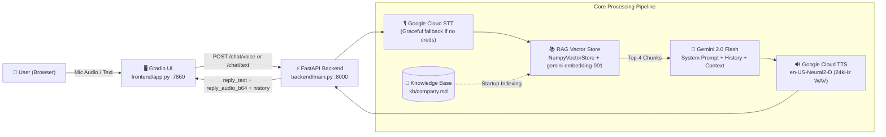
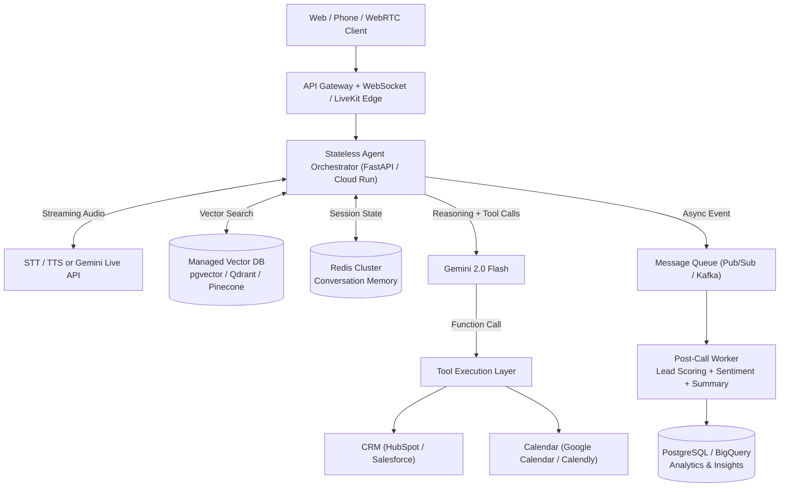

# 🤖 Autonomous AI Sales Voice Agent

An end-to-end **Autonomous AI Sales Voice & Chat Agent** MVP built with **FastAPI**, **Gradio**, **Google Gemini (`google-genai`)**, **NumPy Cosine RAG**, and **Google Cloud Speech (STT/TTS)**.

This repository demonstrates a working core sales workflow grounded in a company knowledge base ([`kb/company.md`](kb/company.md)), alongside a production-ready architectural blueprint covering lead qualification, CRM/calendar automation, call summarization, security, commercial feasibility, and scaling to **100,000+ users**.

---

## 📋 Table of Contents

- [1. Business Problem & Solution](#-1-business-problem--solution)
- [2. Assignment Feature Coverage (MVP vs. Architecture)](#-2-assignment-feature-coverage-mvp-vs-architecture)
- [3. System Architecture Diagram](#-3-system-architecture-diagram)
- [4. End-to-End Business Workflow](#-4-end-to-end-business-workflow)
- [5. Project Structure & Tech Stack](#-5-project-structure--tech-stack)
- [6. Setup & Running Locally](#-6-setup--running-locally)
- [7. Technical Implementation Details](#-7-technical-implementation-details)
- [8. Scalability Strategy (Up to 100,000 Users)](#-8-scalability-strategy-up-to-100000-users)
- [9. Data Security, Infrastructure & Deployment](#-9-data-security-infrastructure--deployment)
- [10. Operational Costs & Commercial Feasibility](#-10-operational-costs--commercial-feasibility)

---

## 🎯 1. Business Problem & Solution

### The Problem
Inbound sales teams—especially at SMBs and growing SaaS companies—struggle with:
- **Slow lead response times:** Prospects drop off when queries wait hours for a human rep.
- **High cost of 24/7 coverage:** Staffing round-the-clock SDRs across time zones is expensive.
- **Inconsistent product answers:** New reps miss pricing nuances, compliance details, or objection-handling scripts.
- **Manual CRM overhead:** Logging calls, summarizing transcripts, and qualifying leads consumes 30–40% of rep time.

### The Solution
**Alex**, an autonomous AI sales assistant powered by **Retrieval-Augmented Generation (RAG)** and **Gemini 2.0 Flash**, engages prospects via voice or text in real time, answers accurately from the company knowledge base, handles common objections, and prepares structured outputs for CRM and calendar handoff.

---

## ✅ 2. Assignment Feature Coverage (MVP vs. Architecture)

| # | Requirement | Status in Repo | Implementation / Architectural Approach |
|---|---|---|---|
| 1 | **Real-time Voice Interaction (STT & TTS)** | ✅ **MVP Implemented** | `POST /chat/voice` accepts base64 `LINEAR16` audio (16 kHz), transcribes via **Google Cloud Speech-to-Text (`speech_v1`)**, and synthesizes spoken responses via **Google Cloud Text-to-Speech (`en-US-Neural2-D`, 24 kHz)** with graceful fallback when Cloud credentials are absent. Production upgrade: WebRTC / Gemini Live bidirectional streaming for sub-500ms latency. |
| 2 | **Contextual Memory & Multilingual Communication** | ✅ **Memory Implemented** / 📐 **Multilingual Architected** | Multi-turn conversation `history` is preserved across turns in Gradio `gr.State` and passed into `client.models.generate_content` (`user`/`model` turns). Multilingual extension: enable automatic language detection in Cloud STT (`alternative_language_codes`) + dynamic TTS voice selection + Gemini multilingual prompting. |
| 3 | **Intelligent Lead Qualification & Sentiment Analysis** | 📐 **Architected** | Designed as a structured JSON tool-calling / post-turn extraction layer using Gemini Structured Outputs (`BANT`: Budget, Authority, Need, Timeline + `sentiment_score` ∈ `[-1, 1]`) to trigger escalation to a human rep on negative sentiment or high-intent Enterprise leads. |
| 4 | **RAG-based Knowledge Retrieval** | ✅ **MVP Implemented** | `kb/company.md` is chunked (400 chars, 80-char overlap), embedded via **`gemini-embedding-001`**, L2-normalized, and queried via cosine similarity in `NumpyVectorStore` (`TOP_K = 4`) before every LLM response to prevent hallucinations. |
| 5 | **Automated Appointment Booking & CRM Integration** | 📐 **Architected** | Designed via Gemini Function Calling (`book_demo(email, datetime)`, `upsert_crm_lead(name, company, plan_interest, notes)`) connected to Google Calendar / Calendly APIs and HubSpot / Salesforce webhooks. |
| 6 | **Call Summarisation & Business Insights** | 📐 **Architected** | End-of-session async worker summarizes conversation `history` into structured CRM notes (pain points, recommended tier, objections raised, next action) and aggregates metrics into a BI store (BigQuery / Postgres). |

---

## 🏗️ 3. System Architecture Diagram

### A. Implemented MVP Pipeline



### B. Target Production Architecture (Full Business Workflow)



---

## 🔄 4. End-to-End Business Workflow

The working prototype demonstrates the complete **Inbound Sales Discovery & Qualification** workflow for **TechNova Solutions** (defined in [`kb/company.md`](kb/company.md)):

1. **Greeting & Discovery:** Prospect asks about plans for a small team (e.g., *"What's your best plan for a 10-person sales team?"*).
2. **RAG Retrieval:** Backend embeds the query with `gemini-embedding-001`, retrieves the top-4 relevant chunks from `kb/company.md` (Growth Plan \$79/mo for up to 15 users, 300 Voice AI mins, CRM automation).
3. **Concise Spoken-Ready Response:** Gemini 2.0 Flash (instructed as **Alex**, max 2–4 sentences for natural voice playback) recommends the **Growth Plan** and highlights the **14-day free trial**.
4. **Objection Handling:** Prospect pushes back (e.g., *"That sounds expensive"* or *"We already use HubSpot"*). Using conversation `history` + retrieved objection-handling chunks, Alex responds empathetically with accurate ROI framing (~\$5/user/day, built-in Voice AI without third-party dialers).
5. **Audio & Visual Delivery:** Response is returned as both text in the Gradio chat window and synthesized WAV audio (`reply_audio_b64`) when Google Cloud TTS is configured.

---

## 📁 5. Project Structure & Tech Stack

```text
sales-voice-agent/
├── .env                  # Environment variables (GEMINI_API_KEY)
├── .gitignore            # Excludes .env, caches, logs
├── requirements.txt      # Python dependencies
├── README.md             # Project documentation & architecture
├── backend/
│   ├── __init__.py
│   └── main.py           # FastAPI server, RAG engine, Gemini LLM, STT/TTS
├── frontend/
│   └── app.py            # Gradio UI (Voice Chat, Text Chat, About tabs)
└── kb/
    └── company.md        # Company knowledge base (TechNova Solutions)
```

| Layer | Technology |
|---|---|
| **LLM** | Google Gemini 2.0 Flash (`google-genai` SDK) |
| **Embeddings** | `gemini-embedding-001` |
| **Vector Search** | Pure-NumPy L2-normalized cosine similarity (`NumpyVectorStore`) |
| **Speech-to-Text** | Google Cloud Speech-to-Text (`google-cloud-speech`) |
| **Text-to-Speech** | Google Cloud Text-to-Speech (`google-cloud-texttospeech`) |
| **Backend API** | FastAPI + Uvicorn + Pydantic |
| **Frontend UI** | Gradio (`frontend/app.py`) |

---

## 🚀 6. Setup & Running Locally

### Prerequisites
- Python **3.10+** (tested on Python 3.14)
- A **Google Gemini API Key** ([Google AI Studio](https://aistudio.google.com/))
- *(Optional, for live Cloud STT/TTS)* A Google Cloud service account JSON key exported as `GOOGLE_APPLICATION_CREDENTIALS`

### Step-by-Step

1. **Configure `.env`**
   ```env
   GEMINI_API_KEY=your_actual_gemini_api_key
   ```

2. **Install dependencies**
   ```bash
   cd sales-voice-agent
   pip install google-genai fastapi "uvicorn[standard]" python-dotenv httpx numpy pydantic gradio pydub markdown
   ```
   *(For Cloud Voice STT/TTS, also install `google-cloud-speech google-cloud-texttospeech`.)*

3. **Start the FastAPI backend (Port 8000)**
   ```bash
   python -m uvicorn backend.main:app --host 0.0.0.0 --port 8000
   ```
   Verify health: `http://localhost:8000/health` → `{"status":"ok","kb_chunks":20}`
   Interactive API docs: `http://localhost:8000/docs`

4. **Start the Gradio frontend (Port 7860)** in a second terminal:
   ```bash
   python frontend/app.py
   ```
   Open **`http://localhost:7860`** in your browser.

> **Note on Voice Fallback:** If `GOOGLE_APPLICATION_CREDENTIALS` is not configured, the **Text Chat** tab works immediately with full Gemini + RAG responses, while STT/TTS fall back gracefully without crashing.

---

## ⚙️ 7. Technical Implementation Details

- **Chunking & Indexing (`backend/main.py`):**
  - Reads `kb/company.md`, splits into 400-character chunks with 80-character overlap.
  - Embeds in batches of 20 using `gemini-embedding-001` (`RETRIEVAL_DOCUMENT`) and normalizes vectors to unit length.
  - Query time embeds user text (`RETRIEVAL_QUERY`) and computes dot product (`self._matrix @ q`) to retrieve top-4 chunks.
- **Stateless API Design:**
  - `POST /chat/text` and `POST /chat/voice` accept `history` in the request body and return updated `history`, keeping the FastAPI worker stateless and horizontally scalable.
- **Voice-First Prompting:**
  - System prompt constrains replies to **2–4 concise sentences** so spoken TTS output sounds natural and avoids long monologues.

---

## 📈 8. Scalability Strategy (Up to 100,000 Users)

To scale from a single-node MVP to **100,000 active users** (assuming ~5–10% peak concurrency = 5,000–10,000 concurrent sessions):

1. **Stateless Horizontal Scaling:**
   - Containerize FastAPI with Docker and deploy on **Cloud Run / Kubernetes (GKE)** with autoscaling based on CPU and concurrent request metrics.
   - Move `history` out of client payloads into a **Redis Cluster** keyed by `session_id` (with TTL) to reduce payload size and enable cross-channel continuity.
2. **Externalize the Vector Store:**
   - Replace in-memory `NumpyVectorStore` with a managed, multi-tenant vector database (**Qdrant**, **Pinecone**, or **PostgreSQL + pgvector** with HNSW indexing), partitioned by `tenant_id`.
   - Cache frequent KB queries and embeddings in Redis (semantic caching cuts LLM/embedding calls by ~30–40%).
3. **Real-Time Voice Streaming:**
   - Upgrade REST base64 audio to **WebSockets / WebRTC** (e.g., LiveKit or Gemini Live API) with Voice Activity Detection (VAD) and barge-in support to drop round-trip latency from ~2.5s to **<500ms**.
4. **Asynchronous Post-Call Pipeline:**
   - Offload call summarization, sentiment scoring, lead qualification, and CRM/Calendar writes to an event-driven queue (**Cloud Pub/Sub / Kafka + Celery/Cloud Tasks**) so user-facing latency stays unaffected.
5. **Rate Limiting & LLM Quota Management:**
   - Implement token-bucket rate limiting per tenant at the API gateway, with provisioned throughput / multi-region Gemini endpoints for high-volume enterprise tiers.

---

## 🔐 9. Data Security, Infrastructure & Deployment

### Data Security & Compliance
- **Secrets Management:** `.env` is excluded via `.gitignore`; in production, store API keys and service credentials in **GCP Secret Manager / AWS Secrets Manager** (never in source control).
- **Encryption:** Enforce **TLS 1.3** in transit (HTTPS/WSS) and **AES-256** encryption at rest for Redis, Postgres, and object storage.
- **PII & Guardrails:** Redact/mask PII (phone numbers, emails, payment info) before sending logs to analytics; enforce strict tenant isolation in vector queries via metadata filters (`tenant_id`).
- **Hallucination Guardrails:** Strict RAG grounding prompt + confidence thresholds; fallback to human handoff when retrieval similarity is below threshold.

### Infrastructure & Deployment
- **Containerization:** Multi-stage `Dockerfile` for `backend` and `frontend` + `docker-compose.yml` for local parity.
- **CI/CD:** GitHub Actions running linting, unit/integration tests (`/health`, `/chat/text` contract tests), container vulnerability scanning, and blue/green or canary rollouts to Cloud Run / GKE.
- **Observability:** Structured JSON logging, OpenTelemetry tracing (STT latency, RAG retrieval time, LLM TTFT, TTS latency), and Prometheus/Grafana dashboards with error-rate alerts.

---

## 💰 10. Operational Costs & Commercial Feasibility

### Estimated Monthly Operational Cost (per 10,000 Active Minutes / ~2,000 Calls)
*(Approximate unit economics using pay-as-you-go cloud pricing)*

| Component | Usage Assumption | Est. Monthly Cost |
|---|---|---|
| **Gemini 2.0 Flash (LLM)** | ~1,500 input + 300 output tokens/turn, 6 turns/call | ~\$5 – \$15 |
| **Gemini Embeddings** | KB indexing + query embeddings | < \$1 |
| **Cloud STT + TTS** | 10,000 mins audio in + synthesized audio out | ~\$160 – \$240 (major cost driver; reducible via Gemini Live / open-source Whisper + Kokoro/Piper TTS) |
| **Compute & Vector DB** | Autoscale containers + Redis + managed pgvector | ~\$50 – \$120 |
| **Total COGS (10k mins)** | | **~\$215 – \$375 / month** (**~\$0.02–\$0.04 / min**) |

### Commercial Feasibility
- **Pricing Alignment:** As modeled in [`kb/company.md`](kb/company.md), the **Growth Plan (\$79/mo for 300 Voice AI mins)** yields **~\$0.26/min** revenue against **~\$0.03/min** COGS (**~85%+ gross margin** at scale).
- **Customer ROI:** Replacing or augmenting a \$4,000–\$6,000/month human SDR for after-hours inbound qualification and FAQ handling delivers immediate payback within days of adoption.
